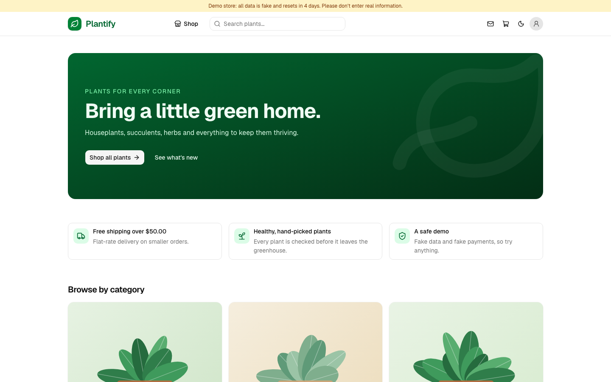
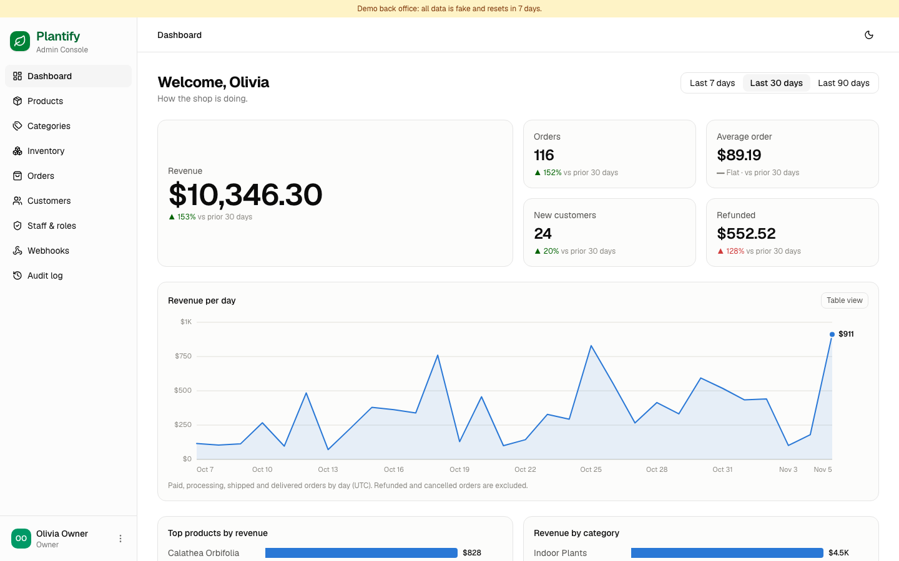
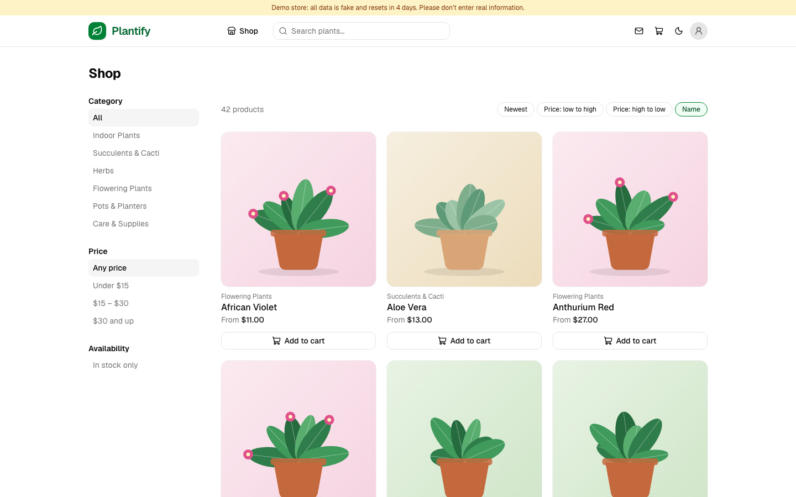
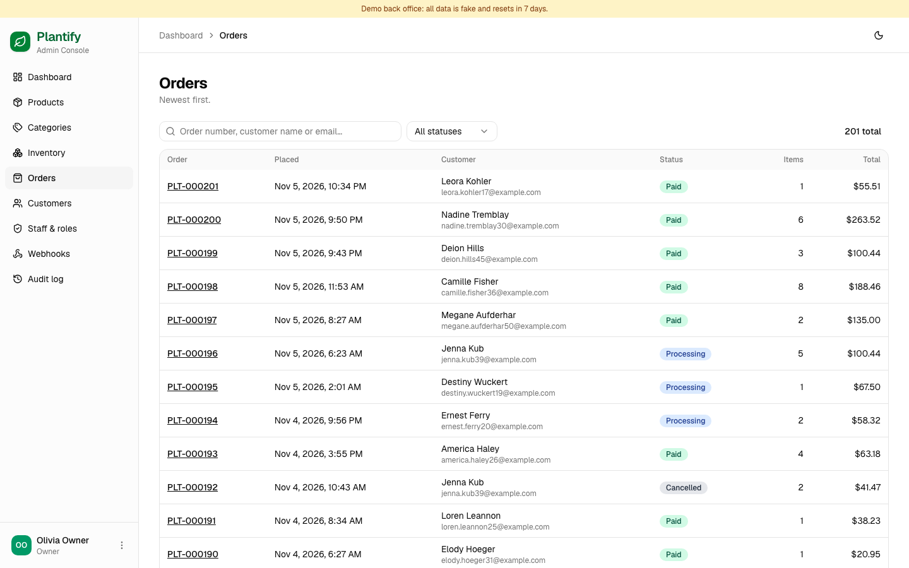

# Plantify

**A demo online plant store with a full admin/ERP back office, built as a TypeScript monorepo: two Next.js apps and a NestJS REST API on PostgreSQL.**

Customers browse, check out as guests or with an account, and pay with a fake card. Staff manage the catalog, stock, orders, refunds and webhooks from a role-based admin. Everything is fake (no real payments or email) and the database is wiped and reseeded every 7 days.

## Live demo

| | |
|---|---|
| **Storefront** | https://plantify-storefront.vercel.app |
| **Admin / ERP** | https://admin-plantify.vercel.app (pick a role and press *Sign in*, no password needed) |

New here? Follow the **[five-minute guide](docs/GUIDE.md)**: it walks through a purchase, then the admin as owner, then the restricted staff roles.





<details>
<summary>More screenshots</summary>





</details>

## What it shows

- **Storefront:** catalog with search and filters, cart, guest checkout or account, fake card payment (including a simulated 3-D Secure step), order history, invoices and saved addresses. Sign-up codes arrive in an in-app demo inbox instead of a real mailbox.
- **Admin / ERP:** products and variants with image uploads, an inventory ledger, orders with fulfilment steps and refunds, customers, a sales dashboard, signed outbound webhooks, staff roles and an audit log.
- **API:** NestJS REST with Better Auth, role-based guards, a signed mock-payment webhook (idempotent), a transactional outbox for outbound webhooks with SSRF protection, rate limits, daily caps and a scheduled reset.

## Tech stack

Next.js 16 · React 19 · Tailwind 4 · shadcn/ui · NestJS · PostgreSQL · Drizzle ORM · Better Auth · Zod · Vitest · pnpm + Turborepo · GitHub Actions · Vercel · Neon

## Repository layout

| Path | What it is | Port |
|---|---|---|
| `apps/api` | NestJS REST API, the only backend | 4000 |
| `apps/storefront` | Customer storefront (Next.js) | 3000 |
| `apps/admin` | Staff admin / ERP (Next.js) | 3001 |
| `packages/contracts` | Shared Zod schemas, types, roles and permissions | |
| `packages/db` | Drizzle schema, migrations, seed data and reset | |

The apps proxy `/api/*` to the API, so auth cookies are first-party and there is no CORS. Authorization is enforced by the API; the UIs only hide what a role cannot use.

## Run it locally

Requires Node >= 22, pnpm 9 and Docker.

```bash
pnpm install
cp .env.example .env
docker compose up -d      # Postgres :5432, Mailpit SMTP :1025 / UI http://localhost:8025
pnpm db:migrate
pnpm db:seed
pnpm dev
```

Open the apps at these hostnames (not plain `localhost`) so the two apps' session cookies do not collide:

- Storefront: http://storefront.localhost:3000
- Admin: http://admin.localhost:3001

**Demo data**

- Admin logins (password `plantify-demo`): `owner@plantify.test`, `catalog@plantify.test`, `orders@plantify.test`. The admin login page offers only these three roles: pick one, then press *Sign in*.
- Sign-up codes appear in the in-app demo inbox, and in Mailpit when `SMTP_URL` is set.
- Demo cards: `1234 5678 9` pays, `0000 0000 0` is declined, `1111 1111 1` asks for a fake 3-D Secure approval (any future expiry, CVC `123`).

## Common commands

```bash
pnpm dev                 # run all apps
pnpm typecheck
pnpm lint
pnpm test                # unit tests
pnpm build
pnpm db:reset            # wipe and re-seed the database
pnpm --filter @plantify/api test:e2e   # API e2e tests (needs migrated + seeded DB)
pnpm --filter @plantify/db generate    # new Drizzle migration after a schema change
```

## Docs

- [docs/GUIDE.md](docs/GUIDE.md): five-minute guided tour
- [docs/DEPLOY.md](docs/DEPLOY.md): Vercel + Neon deployment steps and env vars
- [docs/Plantify-Auth-Journeys.md](docs/Plantify-Auth-Journeys.md): customer sign-up, sign-in and guest checkout flows
- [CLAUDE.md](CLAUDE.md): architecture notes for AI coding assistants (also a good overview of how the parts fit together)

## License

[MIT](LICENSE)
