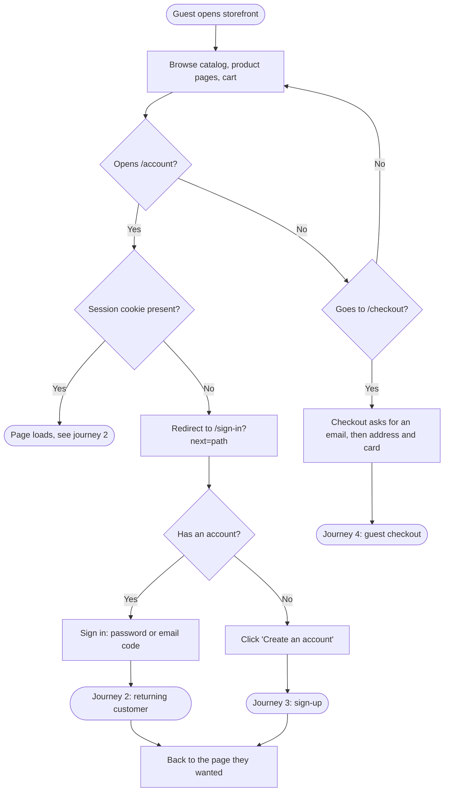
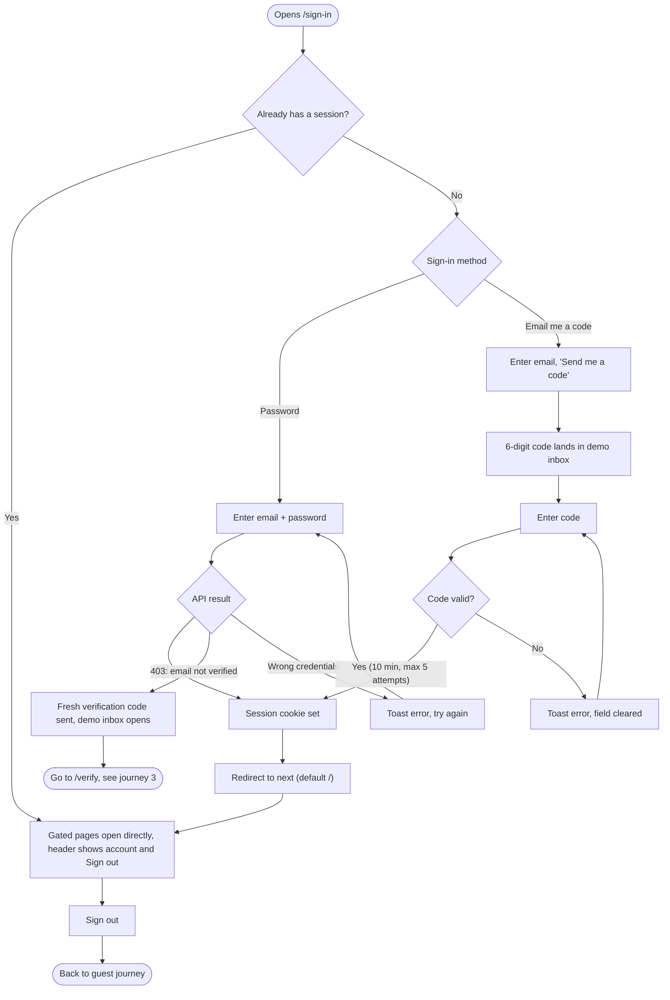
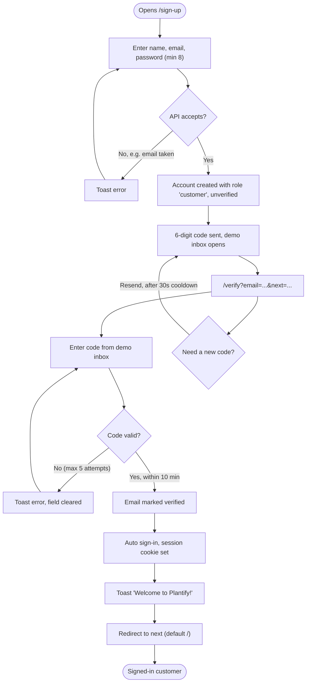

# Plantify customer authentication

How a shopper moves through sign-up, sign-in and the gated pages in the storefront. Derived from `proxy.ts`, the sign-in, sign-up and verify pages, and the Better Auth setup in `auth.service.ts`.

## 1. Guest journey

Browsing is open, and so is checkout: a guest can pay with just an email. Only `/account/*` is gated, and the gate sends the guest to sign-in with a `next` path so they land back where they started.

- The proxy only checks that a cookie exists. The API re-validates the session on every real request, so a forged cookie gets no data.
- The sign-in page reached from checkout (`?next=/checkout`) also offers a "Checkout as a guest" button.

## 2. Returning customer

An existing account signs in with a password or a one-time code. An account that never finished verification is pushed back into verification.

## 3. Sign-up journey

Email verification is required before the first sign-in. Completing the code step signs the new customer in automatically.

- Codes are stored hashed and expire after 10 minutes. Sending is limited to 5 per minute per address; the API as a whole allows 60 auth requests per minute.
- Customers cannot set their own role; staff roles come from the seed only.
- This is a demo: codes arrive in the in-app inbox, not a real mailbox.

## 4. Guest checkout

A guest gives an email, then the same address and card steps as a customer. There is no account, so the order is `user_id = null` with a `contact_email`.

- **Finishing the payment.** Creating the order sets a signed `guest_orders` cookie (up to 5 order ids) that lasts until the browser closes. Pay, confirm and the success page accept either a session or that cookie, and only for orders without an account.
- **Receipt.** The confirmation email lands in the demo inbox for that address (the inbox cookie is granted for the contact email) and holds a "view your order" link, `/orders/track/<orderId>.<expiresAtMs>.<hmac>`, valid for 24 hours. The token is stateless and signed with `BETTER_AUTH_SECRET`.
- **Tracking page.** Public, read-only: status steps with timestamps (from the `order_event` table, filled by a database trigger), items, totals, address and the invoice. An expired link offers a form to request a new one (order number plus email); the answer is always the same, so it cannot be used to discover orders. "Track an order" in the footer opens the same form.
- **Joining an account later.** Signing in needs a verified email, so every new session attaches guest orders with that email to the account (`session.create.after` in `auth.service.ts`). The success and tracking pages offer "Create account" with the email prefilled.
